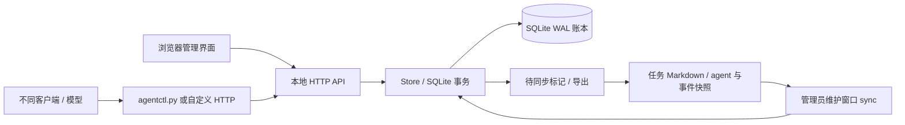

# 架构与一致性边界

任务 `labels` 随任务 JSON 存储及 Markdown 同步；旧任务读出为空数组。
新客户端先核对 health 的 `task_labels` 能力标识，避免旧服务忽略字段。
标签编辑仍由管理员通过事务内 revision 检查完成，与认领能力互不影响。

目标是在单台机器、单个服务进程、多个异构 agent 之间协调任务，保持部署轻量且所有状态可检查。Python 标准库 HTTP 服务提供静态网页与 API；CLI 和网页连接同一进程。

## 组件与数据流



`agentboard/store.py` 处理身份、任务、事务约束、事件、租约与 Markdown。`agentboard/server.py` 做 HTTP 路由、认证、同源检查和静态资源。`agentboard/__main__.py` 处理启动参数。`agentctl.py` 提供跨平台命令行和私有本地凭据。`web/` 为无构建步骤的中文界面，不依赖外部 CDN。

## 持久化

默认目录 `.agentboard/`：

```text
.agentboard/
  board.sqlite3             协调账本
  board.sqlite3-wal/-shm    SQLite 运行时文件，存在时勿单独删除
  admin.token              网页/API 管理凭据
  join.token               注册与读取凭据
  credentials/PROFILE.json 本地 CLI 私有身份、认领、revision
  credentials/PROFILE.lock CLI 同 profile 的 OS advisory lock
  tasks/ID.md              可读任务正文与版本快照
  agents/ID.md             agent 最近状态快照
  events.md                事件快照
  ...                      服务锁与同步元数据
```

SQLite 是共享任务状态的权威来源。Markdown 是可读快照与受控离线编辑入口，不承担互斥协调。agent token / claim token 只在认证或 owner 请求里传递；claim token 永不进入 state 和 Markdown。

## 写入事务与租约

SQLite 启用 WAL、busy_timeout，写操作使用 `BEGIN IMMEDIATE`。每次任务变更在同一事务里完成 revision、owner、租约、claim token、依赖、能力、资源和单 agent 任务限制检查，再写状态、事件与待同步标记。不能把先查再写拆成没有事务保护的两个步骤。

claim_generation 单调增加，为每次认领建立新的令牌世代。过期回收、管理员取消、owner 释放/阻塞/提交会使原认领失效；恢复运行的旧 owner 不能凭旧 token 写进新认领。心跳仅更新租约，不增加任务 revision，避免正常保活和进度无意义地互相冲突。

服务启动和所有读写 API 请求触发过期回收；UI 工作中每 10 秒、空闲每 30 秒查询，隐藏时暂停；状态响应采用 ETag/304 和快照缓存，租约与离线边界会使缓存到期。请求超时可能发生在事务已经提交之后，因此认领有 request_id 幂等机制，其他操作要求客户端读回判断结果。

## 锁的分工

- 服务数据目录的 OS advisory lock：只允许一个进程打开同一目录；进程退出或崩溃后由操作系统释放。
- SQLite 事务锁：串行化共享账本写入，允许多个 HTTP 客户端并发提交。
- 进程内导出锁：避免同一服务内的多个线程同时替换 Markdown 快照。
- CLI profile 锁：保护同一身份的本地令牌、revision 与 pending claim 读改写；不应由两个独立 agent 共用该身份。
- 任务资源锁：依据 workspace 相对路径进行协议级互斥；文件或目录父子覆盖冲突，Windows 大小写折叠。

资源锁不调用 OS 强制锁定源文件，无法阻止绕过 HTTP 的编辑器、Git 命令或失联 agent 写入。参与者需要遵守领取后写、失去租约后停。不要在不可靠网络文件系统上共享服务数据目录；本版本面向本地磁盘和同机进程。

## Markdown 导出与导入

任务变更在数据库里标记待同步项。导出先写同目录临时文件，再 `os.replace` 原子替换，减少半份文件；崩溃后账本保留待同步信息，下次启动可恢复导出。

文件格式是 `---` 包围的 JSON 对象（合法 YAML 子集），后面是 description 正文。JSON 只读状态字段帮助人工检查；导入只接受 title、description、priority、resources、depends_on、required_capabilities、labels，不接受 owner、status 或 revision 的人为改动。

已有文件导入必须和账本 revision 一致，且任务处于 todo/blocked。新文件 revision 为 0，status todo，id 省略或等于安全文件名。推荐 CLI 创建新任务，不要复制现有任务快照来变更身份。

导出会比对已观察到的文件内容/hash，发现外部变化则保留原文件、记录冲突。检查与替换之间不能强制锁住任意外部编辑器，仍存在竞态；原子替换也不等于任意外部进程都能安全并发写。因此离线改文档必须使用暂停写入的维护窗口，不能声称对不遵守协议的文件写入提供线性一致性。

## 网页与上下文

网页只消费 API，不直接读改数据目录。所有用户文本以 textContent 等安全文本节点渲染；任务正文以纯文本展示，避免引入 Markdown 渲染器与不可信 HTML。

上下文是最近一次自报 `{used_tokens,max_tokens,source,note}`，不含完整提示词和会话。服务不推断不同模型的分词与窗口策略，未知保留 null；reported 与 estimated 需在 UI 明示。agent status、工作摘要和进度同样是执行者报告，不能替代成果验收。

## 资源使用

服务复用 UTF-8 状态快照，状态变化失效，最迟 15 秒重查并尊重租约/离线边界；Markdown 缓存 stat/hash 并优先导出待同步项。HTTP 处理线程上限 8。前端使用 ETag 条件请求与自适应低频查询，304 不重建业务 DOM，隐藏视图延迟渲染。推荐 `python -S` 跳过本机 site 启动钩子；实现策略、测量方法与实际边界见 [CPU 与内存](PERFORMANCE.md)。

## 安全范围

服务仅允许环回监听；API 分为 join、agent、admin/session 权限。浏览器认证使用 HttpOnly SameSite=Strict cookie，检查 Origin；CLI 采用 Bearer。不把 token 放查询字符串；可选浏览器登录链接使用 fragment，登录后移除。

这为可信本机协作提供应用权限，不构成对同一系统用户的文件安全隔离。能读取整个数据目录的程序可能读取管理或 agent 凭据。服务不执行任务内 shell 命令，也不读取任意客户端的隐藏上下文。
