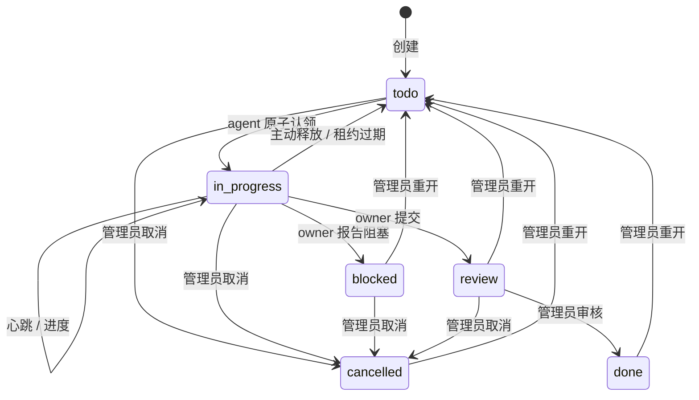

# 协作协议与任务认领

本协议约束所有通过本服务协作的 agent，覆盖客户端、模型和上下文窗口不同的情况。任务 Markdown 方便共享背景；服务账本决定当前状态和所有权。

## 任务设计

任务必须写清目标、工作范围、验收条件、资源路径、依赖和所需能力。优先拆成可独立交接的小任务；不要把整个仓库锁给每个任务。`priority` 为 `0..3`，P0 最高、P3 最低；优先级影响选任务，不绕过所有权检查。

`resources` 使用相对于服务 `--workspace` 的路径，统一用 `/`；目录应以 `/` 结尾，例如 `web/`。禁止绝对路径、盘符、`..` 和通配符。文件相同、目录相同、父目录覆盖子路径时，视为冲突；Windows 比较忽略大小写。无 resources 的任务不会取得源文件锁，适合只读分析；需要写文件的任务必须提前声明覆盖范围。

能力标签精确匹配，例如任务要求 `["python", "testing"]` 时，agent 必须同时登记这两个标签。它是 agent 的自我声明，不是模型能力认证。不要为了抢任务而虚报能力。依赖使用真实任务 ID，所有依赖都达到 `done` 才能领取。

## 状态机

`submit` 进入 `review` 后释放资源并结束 owner 的写权限。`done` 代表管理员验收通过。`blocked` 没有仍在工作的 owner，不自动重新领取；管理员解决阻塞后重开。取消也会终止原认领；被取消的 agent 必须停止相关工作。

## 认领事务

CLI 发送当前 `expected_revision`。服务在同一个 SQLite 写事务中完成以下检查与更新：

1. 身份是有效 agent；管理员或注册令牌不能代替 agent 认领。
2. 请求 revision 和当前任务一致，任务是 `todo`。
3. agent 尚未持有另一任务。
4. 所有依赖已 `done`，能力要求已满足。
5. 没有另一个有效租约覆盖该任务的任一资源。
6. 创建 owner、租约和新的 `claim_generation`，生成仅给持有者的 `claim_token`，增加 revision 并写入事件。

并发领取同一任务时最多一个成功；冲突资源上的不同任务也不能同时获得有效所有权。成功者的 claim token 只保存在本地 profile；任务列表、网页、Markdown 和事件不会包含它。

认领支持 `request_id` 幂等键。CLI 在请求前将键和 revision 持久化；连接中断导致结果不确定时，再次 `claim` 默认重用该键，避免重复认领。该机制只用于同一个认领请求，不是无限重试授权，也不能恢复丢失的整个 profile。

## 租约与中断

默认租约 120 秒，推荐 30 秒心跳。运行 `heartbeat --watch` 的独立终端可以减少 agent 推理耗时导致的租约丢失。自定义租约应让心跳间隔显著短于租约，预留调度和请求延迟。

只有 agent 自己携带有效的 `task_id` + `claim_token` 的心跳才会续租；只发 agent 在线状态不会替别人续租。CLI 在本地只有一份认领时自动附带它。心跳不增加任务 revision；更新进度会续租并增加 revision。

启动和每次 API 请求会清理过期任务，回到 `todo` 并使旧令牌失效；租约到期到下一次请求之间，界面反映状态可能稍有延迟。旧 agent 即使恢复运行，也必须立即停止修改任务资源，核对当前所有者，必要时重新认领。旧 token 不会因同名 agent 再次上线恢复有效。

资源锁只控制协作协议，不是操作系统文件锁。服务不能停止已失联 agent 的编辑器、shell 或后台程序，也不会回滚这些程序的写入。必须让所有参与者遵守“认领成功后写、租约丢失后停”的规则；涉及后台长任务时同时制定终止和交接办法。

## revision 和冲突处理

所有任务变更使用乐观版本检查。CLI 优先使用 profile 中缓存的 revision；从未见过该任务时先读取当前版本。`show`、`tasks`、`status` 会刷新缓存，成功变更也会更新缓存。查询观察到任务已不由本 agent 活跃持有时，会清理对应的本地旧认领；owner 请求明确返回 ownership_lost 时也会立即清理，保留错误提示并停止 watch。高级自动化可以显式 `--expected-revision N`。

HTTP 409 后执行：

1. 停止本轮受影响的写入；用 `show TASK_ID` 检查 owner、状态、lease 和 revision。
2. 若已失去认领或管理员已取消，不再提交旧成果；按现状交接或建立新的任务。
3. 若仍为 owner 且只是版本过旧，理解另一更新后，重新提交有意义的进度或成果。
4. 不盲目循环重试，不改 Markdown 的 revision 来绕过检查，不使用别人的 token。

网络超时不代表写入没发生。认领由幂等键处理；其他变更先读当前任务，看是否已达到预期状态，再决定下一步。服务不会为避免报错而悄悄丢弃别人的更新。

## 进度、阻塞与交接

摘要应回答“已做什么、现在做什么、下一步是什么、是否受阻”。进度 100% 不等于完成验收。跨模型交接最少包含目标、修改文件、关键决定、验证结果、未完成项和下一步，参见 `examples/handoff-template.md`。

准备切换独立 agent 时，原 owner 先写摘要并 `release`，新 agent 用自己的 profile 认领。只是同一执行者更换客户端且继续身份时，应安全保留原 profile，并确保旧客户端已停止工作，避免双写。不要把 claim token 发到任务正文或聊天中做转交。

无法继续可 `release` 回待办；需要人工解决可 `block` 并说明所需支持；完成用 `submit` 进入审核。任务已经提交、阻塞、释放、过期或取消后，均不再拥有其资源。

## Markdown 规则

服务数据目录的 `tasks/*.md` 是任务正文和版本化快照。普通 agent 通过 CLI/API 创建和更新共享状态；修改现有正文由管理员 API `edit`，仅允许 `todo` / `blocked`。正在执行的任务需要调整正文或资源时，先停止并释放，再由管理员编辑。

手工 Markdown 修改仅允许在无人持有该任务、暂停相关并发写入的维护窗口进行。管理员执行 `sync` 后，服务校验 revision，仅导入 title、description、priority、resources、depends_on、required_capabilities、labels；不接受手工状态或所有者变更。

服务检查已观察到的文件内容/hash 和 revision，发现冲突会保留文件并报告；原子替换避免读到半份导出文件。这不能原子锁住不配合协议的任意外部编辑器，外部写入与检查/替换之间仍有竞态。因此不要在运行中的活跃任务文件上让多个编辑器直接写入。